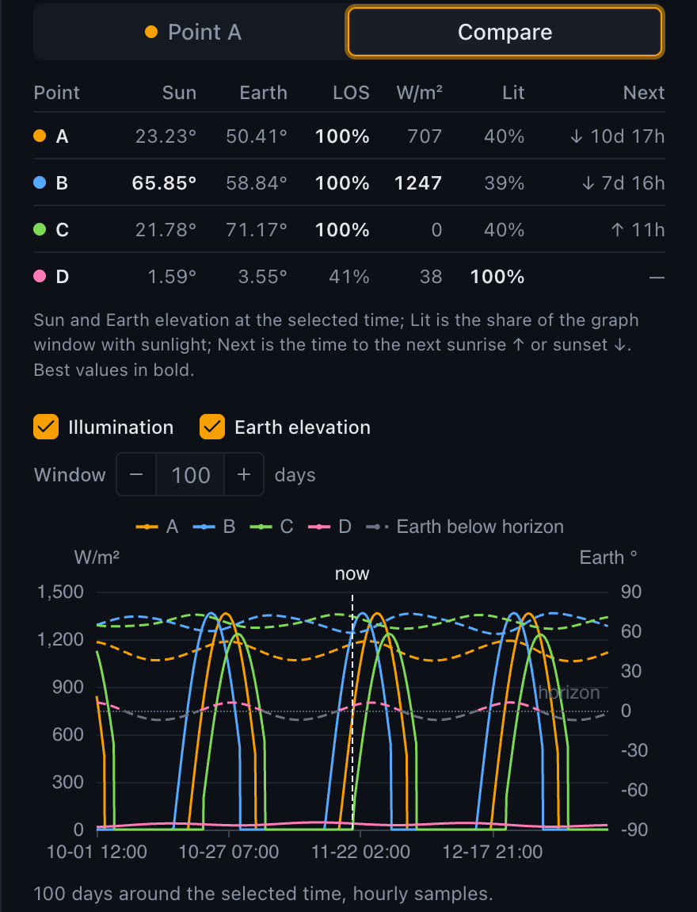

# Earthrise

**Sun, Earth and terrain for any point on the Moon, at any moment.**

Built for **NASA Space Apps Challenge 2026 (Dnipro)**.

Earthrise is a web app for lunar mission planning. Pick any point on the Moon,
pick a moment in time, and it tells you where the Sun and the Earth are in that
point's sky, how much sunlight reaches the ground, and when Earth is in view for
a radio link — all computed from real NASA ephemerides and a 100 m terrain model.

> A radio link to Earth needs line of sight; a solar panel needs the Sun.
> Earthrise puts both on one time axis, for the exact spot you care about.

<p align="center">
  
</p>

<p align="center"><em>Compare up to four sites: a ranked table and overlaid illumination + Earth-elevation curves on one time axis.</em></p>

---

## What it does

- **Pick any point on the Moon.** A 3D globe rendered on NASA LROC imagery and
  LOLA relief. Click the globe or type coordinates; drop up to **four pins
  (A–D)**, each in its own colour.
- **Illumination, hour by hour.** Solar insolation (W/m²) at the chosen point,
  right now and as an hourly time-series over any window you type — from 1 day
  up to a full year (8 760 samples) in about 0.3 s. The flux is the solar
  constant projected onto the **real ground slope**.
- **Terrain shadowing.** A 360° horizon profile built from the LRO 100 m
  elevation model, ray-marched out to 263 km, cuts the Sun (and Earth) off when a
  ridge is in the way — not just a flat-horizon approximation.
- **Earth in the sky.** Earth's elevation on the same chart (blue above the
  horizon, grey below), plus line-of-sight windows: rise, set, duration and peak
  elevation for each pass, and the share of the period Earth is visible.
- **Sunrise / sunset.** The next day/night transition and the lit share of the
  window, per site.
- **Compare up to four sites** side by side at one moment: Sun and Earth
  elevation, range, watts, lit share and next transition, with the best value in
  each column highlighted and every site's curve overlaid in its pin colour.
- **Stand on the surface.** A first-person view that drops you onto the real
  terrain (LRO 100 m relief), lit from the Sun's actual direction, with the Sun
  and Earth placed at their true azimuth, elevation and angular size (Earth even
  shows its phase). Drag to look around, jump to the Sun or Earth from the
  legend, Esc to return.
- **Everything lives in the URL.** Points, active pin, time and graph window are
  mirrored into the link (`?pts=lat,lon;lat,lon&active=&utc=&days=`), so sharing
  the URL reproduces the exact view for a colleague.

---

## Architecture

```
┌───────────────────────────┐        /api/*        ┌──────────────────────────┐
│ Frontend (React + Vite)   │  ───────────────────▶ │ Backend (FastAPI)        │
│  react-globe.gl globe     │                       │  spiceypy  → Sun/Earth   │
│  three.js surface scene   │  ◀─────────────────── │  GLD100 DEM → terrain    │
│  ECharts dual-axis chart  │       JSON             │  SPICE DE440 ephemerides │
└───────────────────────────┘                       └──────────────────────────┘
```

### Backend — FastAPI + `spiceypy`
- Sun and Earth position for an observer on the lunar surface (azimuth,
  elevation, range, light-time), in the `MOON_ME` (Moon Mean Equator) body-fixed
  frame using **SPICE DE440** ephemeris kernels.
- Hourly **insolation** and **Earth-visibility** time-series.
- A 360°-azimuth **horizon profile**, ray-marched to 263 km over the terrain
  model, so shadowing by distant ridges is accounted for.
- **Landscape** endpoints that sample the DEM for the first-person scene.

### Frontend — React 18 + TypeScript + Vite
- `react-globe.gl` globe + a custom `three.js` first-person surface scene.
- ECharts dual-axis chart (illumination + Earth elevation) with LTTB
  downsampling.
- [Feature-Sliced Design](https://feature-sliced.design/), with all app state
  mirrored to the URL.
- Tailwind CSS v4 + [shadcn/ui](https://ui.shadcn.com/) components.

### Data
- **SPICE DE440** generic kernels (NAIF) — ephemerides and the lunar reference
  frame.
- **LRO LROC WAC GLD100** elevation model, 100 m/pixel, 10 tiles (~3.8 GB) —
  terrain, slope and horizon profiles.
- **NASA SVS CGI Moon Kit** colour mosaic and relief maps — the globe texture.

---

## Project layout

```
.
├── docker-compose.yml        # backend + frontend (nginx) services
├── backend/
│   ├── app/
│   │   ├── main.py           # FastAPI app; loads kernels + map on startup
│   │   ├── routers/positions.py   # /positions/* endpoints
│   │   ├── service/
│   │   │   ├── spice_service.py        # Sun/Earth positions, insolation
│   │   │   └── landscape_service.py    # GLD100 DEM, slope, horizon profile
│   │   ├── schemas.py / models.py / database.py
│   ├── kernels/              # SPICE kernels (git-ignored, see setup)
│   ├── moon-map/             # GLD100 DEM tiles (git-ignored, see setup)
│   ├── download_kernels.sh   # fetches the SPICE kernels
│   ├── requirements.txt
│   └── Dockerfile
└── frontend/
    ├── src/                  # Feature-Sliced Design (app/pages/widgets/…)
    ├── package.json
    ├── nginx.conf            # proxies /api/* → backend in the Docker image
    └── Dockerfile
```

Both `backend/README.md` (the HTTP API reference) and `frontend/README.md` (the
Feature-Sliced layer guide) have more detail for contributors.

---

## Setup

### Prerequisites
- **Docker** + Docker Compose (simplest path), **or**
- **Python 3.11+** and **Node.js 18+** for running the two services directly.

### 1. Get the data (required)

The large binary data sets are **not** committed to the repo (see `.gitignore`).

**SPICE kernels** (~45 MB) — run the download script:

```bash
cd backend
./download_kernels.sh          # fetches 5 DE440 kernels into backend/kernels/
```

This pulls `naif0012.tls`, `de440s.bsp`, `pck00011.tpc`,
`moon_de440_250416.tf` and `moon_pa_de440_200625.bpc` from
`naif.jpl.nasa.gov`.

**GLD100 terrain tiles** (~3.8 GB) — these power the terrain, slope and
first-person features. Place the 10 `WAC_GLD100_*_100M.IMG` tiles in
`backend/moon-map/`. Either:

- **Auto-download:** create `backend/.env` with `SHOULD_DOWNLOAD_MAP=True`. On
  the next startup the backend fetches the tiles from the NASA LROC PDS server
  into `backend/moon-map/`, **or**
- **Manual:** download the full-precision `.IMG` tiles yourself from
  `https://pds.lroc.im-ldi.com/data/LRO-L-LROC-5-RDR-V1.0/LROLRC_2001/DATA/SDP/WAC_GLD100/`
  into `backend/moon-map/`.

> The terrain data is optional to start the server — if no tiles are found the
> app runs with all landscape/terrain features disabled (positions and
> flat-horizon insolation still work).

### 2a. Run with Docker (recommended)

```bash
docker compose up -d --build
```

- Frontend: **http://localhost** (port 80, nginx proxies `/api/*` to the backend)
- Backend: **http://localhost:8000** (interactive API docs at `/docs`)

The `moon-map/` directory is mounted read-only into the backend container, so the
tiles are served from the host rather than copied into the image.

### 2b. Run the services directly (for development)

**Backend:**

```bash
cd backend
pip install -r requirements.txt
uvicorn app.main:app --reload       # http://localhost:8000
```

**Frontend:**

```bash
cd frontend
npm install
npm run dev                          # http://localhost:5173
```

The Vite dev server proxies `/api/*` to `http://localhost:8000` (override with
`VITE_API_TARGET`). Open **http://localhost:5173**.

---

## API at a glance

All routes are under `/positions` (full reference + schemas in
`backend/README.md`, or the live Swagger UI at `http://localhost:8000/docs`).

| Method & path | Purpose |
|---|---|
| `POST /positions/surface` | Sun & Earth position + current insolation and ±1-lunar-day graph for a point |
| `POST /positions/earth-visibility` | Earth line-of-sight windows (rise/set/duration/peak) over a time range |
| `GET  /positions/insolation` | Hourly insolation series over a time range |
| `GET  /positions/landscape` | DEM elevation samples along a lat/lon rectangle (for the surface scene) |
| `GET  /positions/landscape/low-res` | Down-sampled global DEM |
| `GET  /health` | Liveness check |

---

## Tech stack

**Backend:** Python, FastAPI, spiceypy (NASA SPICE), NumPy, SQLite.
**Frontend:** React 18, TypeScript, Vite, react-globe.gl, three.js, ECharts,
Tailwind CSS v4, shadcn/ui.

**NASA data:** SPICE DE440 ephemerides · LRO LROC WAC GLD100 100 m DEM ·
SVS CGI Moon Kit maps.
